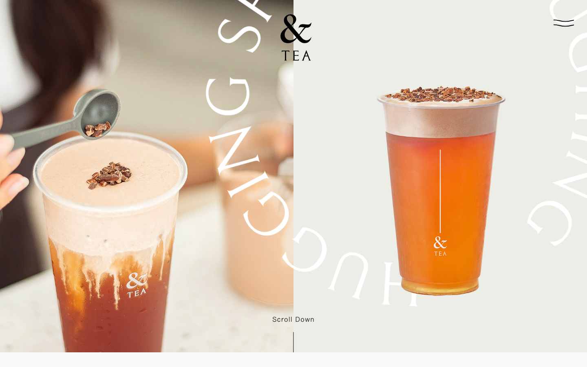
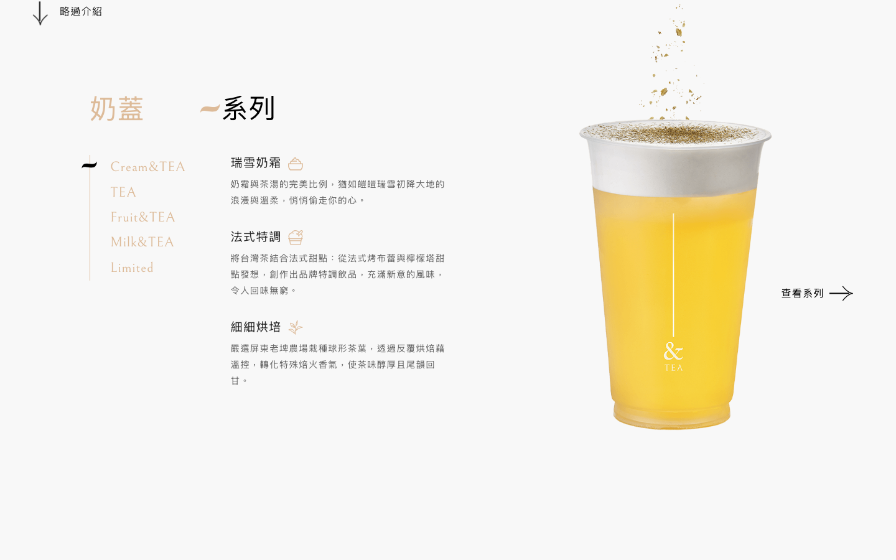
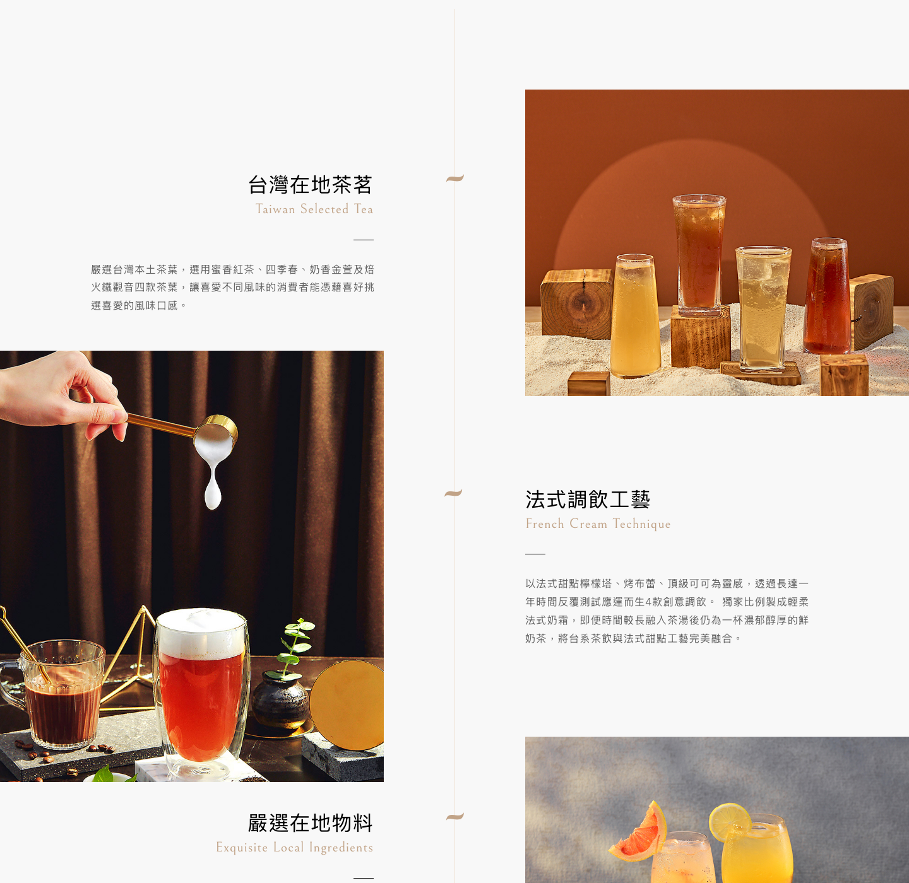
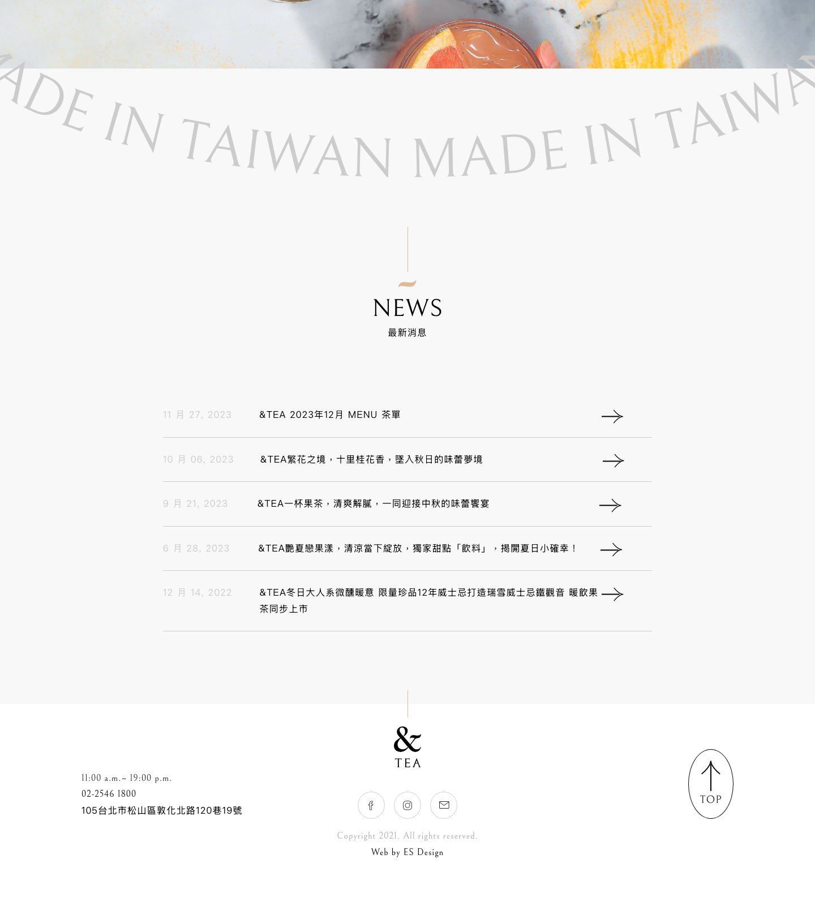
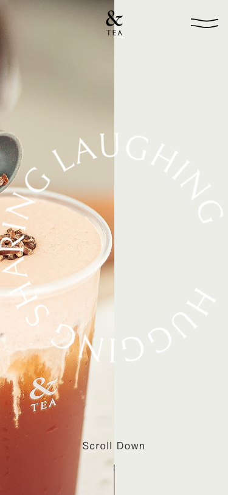
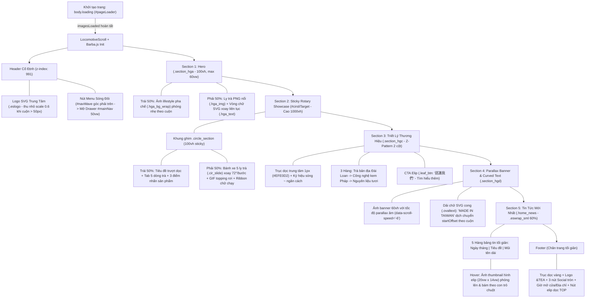

# Phân Tích Giao Diện & Hệ Thống Thiết Kế: &TEA (`andtea.com`)

> [!IMPORTANT]
> Báo cáo này được trích xuất trực tiếp từ mã nguồn thực tế (`main.css`, `ani.css`, `rwd.css`, `normalize.css`, `scripts.js`, `es.js`) kết hợp kiểm tra kết xuất trực quan đa khung nhìn (`1440×900` Desktop & `375×812` Mobile) bằng công cụ kiểm toán `render-check.mjs` của bộ kỹ năng **AgentKit (`ak-frontend-design` + `ak-ui-ux-pro-max`)**.

---

## 1. Hình Ảnh Kết Xuất Thực Tế (Visual Render Snapshots)

### 1.1. Hero Section — Desktop (`1440×900`)


### 1.2. Sticky Circle Slider — Desktop (`1440×900`)


### 1.3. Brand Craft Z-Pattern Intro — Desktop (`1440×1400`)


### 1.4. Curved SVG Text, News List & Footer — Desktop (`1440×1600`)


### 1.5. Hero Section — Mobile (`375×812`)


---

## 2. Design Brief (Theo chuẩn `ak-frontend-design`)

```text
Register:  Brand (Editorial F&B / Artisanal Tea & French Cream Concept Store)
Scene:     Khách hàng trẻ yêu thích trà thủ công và phong cách sống tinh tế tại Đài Loan,
           trải nghiệm trên cả Desktop và Mobile trong không gian sáng, nhẹ nhàng, thư thái.
Direction: French-Taiwanese Editorial Minimalism — kết hợp nét thanh lịch cổ điển Pháp
           (serif mảnh, đường elip nghiêng, sắc kem trà) với nhịp điệu tạp chí hiện đại.
Color:     Restrained; bg #F8F8F8 (oklch(0.978 0 0)), text #282828 (oklch(0.278 0 0)),
           accent #DDBB99 (oklch(0.812 0.058 68.5)) & #C1A387 (oklch(0.735 0.056 66.8))
Type:      Bellefair (Display Serif) + PingFang TC / Helvetica Neue (Body Sans);
           trục tương phản: High-contrast Classical Serif (EN) vs Clean Humanist Sans (ZH-TW)
Signature: Sticky 1000vh Rotary Drink Showcase (5 ly trà xoay quỹ đạo 72° mỗi bước cuộn
           kèm hiệu ứng GIF nguyên liệu rơi phía trên miệng ly và đổi màu nền pastel).
Dials:     variance 8/10, motion 8/10, density 3/10 (nhiều khoảng thở trắng)
```

---

## 3. Hệ Thống Design Tokens (CSS Variables Trích Xuất)

```css
:root {
  /* === 1. COLOR TOKENS === */
  /* Base & Surfaces */
  --bg-primary: #F8F8F8;          /* Nền tổng thể toàn trang */
  --bg-hero: #EDEDE8;             /* Nền khối Hero nửa phải (Warm Alabaster) */
  --bg-surface-alt: #EBEBE8;      /* Nền khối phụ trang About & placeholder ảnh */
  --bg-elevated: #FFFFFF;         /* Nền Header Drawer, Footer, Popup */
  --bg-overlay: rgba(255, 255, 255, 0.70); /* Nền Video Popup (kèm blur 10px) */

  /* Dynamic Series Pastel Backgrounds (Sticky Circle & Drink Slider) */
  --bg-series-cream: #FDF9E8;     /* Dòng 1: Cream & TEA (奶蓋 - Vàng kem nhạt) */
  --bg-series-tea: #FFF8EF;       /* Dòng 2: TEA (純茶 - Cam trà nhạt) */
  --bg-series-fruit: #F8FFFE;     /* Dòng 3: Fruit & TEA (果茶 - Xanh bạc hà nhạt) */
  --bg-series-milk: #FAFAFA;      /* Dòng 4: Milk & TEA (歐蕾 - Trắng sữa) */
  --bg-series-limited: #FFF8F8;   /* Dòng 5: Limited (期間限定 - Hồng phấn nhạt) */

  /* Text Hierarchy */
  --text-strong: #000000;         /* Tiêu đề chính, liên kết, icon điều hướng */
  --text-body: #282828;           /* Nội dung văn bản mặc định */
  --text-muted: #666666;          /* Mô tả phụ trong giới thiệu & sản phẩm */
  --text-subtle: #808080;         /* Phụ đề tiếng Anh trong Menu, tag, social */
  --text-disabled: #AAAAAA;       /* Bản quyền footer */
  --text-faint: #CCCCCC;          /* Ngày tháng tin tức, chữ cong MADE IN TAIWAN */

  /* Brand Accents & Borders */
  --accent-primary: #DDBB99;      /* Champagne Gold / Warm Tea Cream (chủ đạo) */
  --accent-secondary: #C1A387;    /* Muted Caramel / Hover CTA / Selection bg */
  --accent-border-pill: #AF9983;  /* Viền nút elip .leaf_btn */
  --border-hairline: #EFE0D2;     /* Đường trục dọc trung tâm (.sec_line) */
  --border-neutral: #D1D1D1;      /* Viền nút social, nút Buy Now */
  --border-divider: #CCCCCC;      /* Đường kẻ ngang phân cách danh sách News/Menu */
  --state-success: #7BAA82;       /* Màu icon thông báo copy link thành công */

  /* === 2. TYPOGRAPHY TOKENS === */
  --font-display: 'Bellefair', serif;
  --font-sans: 'PingFang TC', 'Helvetica Neue', 'Helvetica', 'Arial', sans-serif;
  --font-icon: 'fontello';

  --font-size-root: 16px;         /* 20px trên màn hình >= 1600px */
  --font-size-jumbo-marquee: 10vw;/* Chữ chạy ngang trang About (20vw trên mobile) */
  --font-size-curved-svg: 8vw;    /* Chữ cong MADE IN TAIWAN */
  --font-size-ribbon: 7vw;        /* Chữ chạy nền .ciriboon & .core_visual */
  --font-size-hero-svg: 6.3rem;   /* Chữ xoay tròn HUGGING SHARING LAUGHING */
  --font-size-h1: 4.5vw;          /* Tiêu đề H1 mặc định */
  --font-size-nav-link: 4vw;      /* Link trong menu trượt (12vw trên mobile) */
  --font-size-sec-title: 3vw;     /* Tiêu đề .title_leaf h2 & .cirin_title h2 */
  --font-size-h2: 2rem;           /* 32px */
  --font-size-h3: 1.6rem;         /* 25.6px */
  --font-size-lead: 1.4rem;       /* 22.4px - phụ đề .bellfont, danh mục trà */
  --font-size-subhead: 1.2rem;    /* 19.2px - tiêu đề đặc điểm .cir_des h3 */
  --font-size-body: 1rem;         /* 16px */
  --font-size-small: 0.9rem;      /* 14.4px - mô tả .cir_des p, nút .buynow */
  --font-size-xs: 0.8rem;         /* 12.8px - toast message, tag link */

  --line-height-body: 1.8;
  --line-height-heading: 1.4;
  --letter-spacing-base: 1px;
  --letter-spacing-wide: 2px;

  /* === 3. LAYOUT & SPACING TOKENS === */
  --container-main: 80%;          /* .eswrap (100% + padding 2rem trên mobile) */
  --container-narrow: 60%;        /* .eswrap_sml (dùng cho News & Menu) */
  --radius-pill: 100px;
  --radius-ellipse: 100%;         /* Tạo hình elip nghiêng đặc trưng khi w != h */

  /* === 4. MOTION & EASING TOKENS === */
  --ease-editorial-in-out: cubic-bezier(0.76, 0, 0.24, 1); /* Mở nav, đổi ly, mở accordion */
  --ease-smooth-out: cubic-bezier(0.25, 1, 0.5, 1);        /* Xuất hiện Hero, Page loader */
  --dur-fast: 0.3s;
  --dur-medium: 0.5s;
  --dur-dramatic: 1.0s;
  --dur-reveal: 2.0s;
}
```

---

## 4. Kiến Trúc Bố Cục & Luồng Cuộn (Layout & Scroll Architecture)

Trang web được thiết kế bởi studio **ES Design (Đài Loan)** trên nền WordPress tùy biến hoàn toàn, vận hành như một **Single-Page Application (SPA)** nhờ sự kết hợp giữa **Barba.js** (chuyển trang không tải lại) và **Locomotive Scroll v4.0.6** (cuộn mượt quán tính + điều khiển hoạt ảnh theo tọa độ `scroll.y`).



---

## 5. Phân Tích Chi Tiết Từng Thành Phần (Component & Craft Breakdown)

### 5.1. Hệ thống nhận diện hình học (Signature Geometric Motifs)
Điểm đắt giá nhất tạo nên cá tính riêng của `&TEA` là **không dùng khung hình chữ nhật bo góc thông thường (`border-radius: 8px`)**, mà xuyên suốt toàn trang sử dụng **4 họa tiết hình học thủ công**:
1. **Hình Elip mảnh (`border-radius: 100%` trên khung chữ nhật, `border: 1px solid #DDBB99` hoặc `#000`)**:
   - Nút CTA `.leaf_btn` (`14rem × ~4.5rem`), nút `#backtop` (`5rem` dọc), khung tuyên ngôn `.bcs_inner` (xoay nghiêng `-5deg`), vòng elip nền `.core_visual:before` (`40vw × 20vw`, xoay `-20deg`), và khung ảnh thumbnail xuất hiện khi di chuột vào bài viết (`.listpost figure`: `20vw × 14vw`).
2. **Đường trục mảnh `1px` (`Hairline Vertical Axis`)**:
   - Xuất hiện ở chỉ báo `Scroll Down` (`.scr_line`), tiêu đề mục (`.title_leaf .deco:before` cao `5rem` màu `#DDBB99`), trục giữa `.sec_line` (`#EFE0D2`), và phía trên logo chân trang (`.footlogo:before`).
3. **Ký hiệu dấu ngã / lá trà (`\e80d` trong bộ icon `fontello`)**:
   - Đóng vai trò là điểm nhấn thị giác (bullet/ornament) đặt dưới đường thẳng `1px`, nằm giữa tiêu đề tiếng Trung và chữ *"系列"*, hoặc trượt dọc làm con trỏ chỉ mục đang chọn trong `#cirinList` và `.cream_navs`.
4. **Mũi tên đường kẻ răng cưa/vẽ tay (`.arrow .line:before` dùng `arrow_line.svg`)**:
   - Khi hover vào các nút hoặc dòng tin tức, dải SVG dài `40rem` bên trong khung `2rem` (`overflow: hidden`) chạy ngang `90%` trong `3s` (`horiLineAni`), tạo hiệu ứng nét vẽ chuyển động liên tục.

### 5.2. Header & Navigation Drawer (`#header`, `#navWave`, `#mainNav`)
* **Logo trung tâm (`.eslogo`)**: Cố định tại `top: 2rem; left: 50%`, rộng `5rem`. Khi hover, path SVG chuyển từ `fill: #000` sang nét viền rỗng `stroke: #000`. Khi cuộn xuống quá `50px`, `header.scroll .eslogo` thu nhỏ còn `scale(0.6)` và dính sát `top: 0`.
* **Nút Menu Sóng Đôi (`#navWave`)**: Thay vì icon Hamburger 3 gạch nhàm chán, sử dụng 2 đường sóng sin SVG dài `455.9px` đặt trong khung `50×50px` (`overflow: hidden`).
  * **Hover**: Đường sóng trượt ngang `-400px` trong `5s`, tạo chuyển động gợn sóng êm ái.
  * **Click (`header.navopen`)**: Hai đường sóng xoay chéo `15deg` và `-15deg` tạo thành dấu `X`, đồng thời chữ `CLOSE` trượt từ dưới lên (`translateY(2rem -> 0)`).
* **Menu Trượt (`#mainNav`)**: Chiếm `50vw × 100vh` bên phải (trên mobile là `100vw`). Nền trắng mở ra từ phải sang trái (`transform-origin: 100% 0`, `scaleX(0 -> 1)` với `cubic-bezier(0.76, 0, 0.24, 1)` trong `1s`). Ba mục lớn (`ABOUT`, `DRINKS`, `NEWS`) cỡ chữ `4vw` xuất hiện lệch nhịp (`staggered delay: 0.3s, 0.4s, 0.5s`), trong đó mục thứ 2 (`DRINKS`) được thụt lề phải `8vw` tạo bố cục nhịp điệu bất đối xứng.

### 5.3. Khu vực Hero (`.section_hga`)
* **Bố cục**: Chia đôi màn hình 50/50 trên nền `#EDEDE8`.
  * **Nửa trái (`.hga_bg_wrap`)**: Ảnh chụp cận cảnh bàn tay đang rắc vụn cacao lên lớp kem phô mai. Khi cuộn, ảnh phóng nhẹ theo công thức `scale(1 + scrollY / 2000)`.
  * **Nửa phải (`.hga_img` + `.hga_text`)**: Ảnh tách nền ly trà Bá Tước phủ kem cacao (`巧霜伯爵紅.png`) đặt nổi phía trước vòng chữ SVG khổng lồ (`77vw × 77vw`) mang dòng chữ `"HUGGING SHARING LAUGHING"` bằng font `Bellefair` màu trắng (`#FFFFFF`).
* **Tương tác cuộn**: Hàm `ES.circleTrack` xoay vòng chữ liên tục mỗi frame (`0.3deg/frame`), và **tăng tốc độ xoay tỉ lệ thuận với tốc độ vuốt/cuộn chuột (`scrSpeed`)** của người dùng.

### 5.4. Vòng xoay sản phẩm ghim cố định (`#cirsliTarget` / `.circle_section`)
* **Cơ chế hoạt động**: Khối `#cirsliTarget` có chiều cao `1000vh` (gấp 10 lần màn hình), giữ khối con `.circle_section` ghim cố định (`data-scroll-sticky`).
* **Bánh xe 5 ly nước (`.cir_slide`)**:
  * 5 dòng sản phẩm (*Cream&TEA, TEA, Fruit&TEA, Milk&TEA, Limited*) được đặt chồng lên nhau với tâm xoay bên phải màn hình (`transform-origin: 100% 50%`), cách đều nhau đúng **`72deg`** (`360° / 5 = 72°`: `0°`, `-72°`, `-144°`, `-216°`, `-288°`).
  * Khi người dùng cuộn dọc qua `1000vh`, góc xoay được nội suy tuyến tính: `curAngle = (scrV - cirSec.top) * 288 / secHei`.
  * Khi một ly đi vào vùng góc nhìn (`-50° <= startAngle <= 30°`):
    1. Class `.in` kích hoạt (`opacity: 1`).
    2. Sau `1s`, ảnh động `.cir_gifimg` (hạt trà/kem/trái cây rơi lơ lửng phía trên miệng ly) hiện lên (`opacity: 1`).
    3. Màu nền toàn bộ section đổi mượt (`transition: background-color 0.2s`) theo `data-bgcolor` của dòng trà đó (`#fdf9e8` -> `#fff8ef` -> `#f8fffe` -> `#fafafa` -> `#fff8f8`).
    4. Cột bên trái tự động trượt tiêu đề tiếng Trung (`#cirTitlezh`), di chuyển icon chiếc lá cạnh danh sách tiếng Anh (`#cirinList`), và làm mờ/đổi nội dung 3 điểm đặc trưng (`#cirDes`).
    5. Dải chữ lớn dưới đáy (`.circle_ribbon` cỡ `7vw`) đổi chữ tương ứng và dịch chuyển ngược chiều chuột (`ES.followCursorPara`).
  * **Tính năng UX thông minh**: Có nút **"略過介紹" (Bỏ qua giới thiệu - `.cir_skip`)** ở góc trái trên để người dùng nhảy thẳng xuống phần tiếp theo nếu không muốn cuộn hết `1000vh`, cùng cơ chế tự động bắt điểm dừng (scroll-snap bằng JS khi tốc độ cuộn giảm xuống).

### 5.5. Danh sách Tin tức với Hiệu ứng Cursor-Follow (`.home_news`)
* Cấu trúc bảng tối giản rộng `60%` (`.eswrap_sml`), mỗi dòng chỉ gồm: Ngày đăng (`#ccc`), Tiêu đề (`70%`), và Mũi tên bên phải.
* Khi di chuột vào từng dòng (`.listpost`), hàm `ES.followCursorInSec` tính toán tọa độ chuột tương đối trong dòng đó và dùng nội suy tuyến tính (`lerp` với hệ số `speed = 0.1`) để kéo một khung ảnh hình elip (`20vw × 14vw`, `opacity: 0.6`, `scale(0 -> 1)`) trượt mượt theo con trỏ chuột.

---

## 6. Kiểm Toán UX, Responsive & Accessibility (Theo `ak-ui-ux-pro-max` & `render-check.mjs`)

Bên cạnh giá trị thẩm mỹ nghệ thuật rất cao, kết quả chạy kiểm toán tự động bằng `render-check.mjs` và đối chiếu bộ quy tắc `ak-ui-ux-pro-max` chỉ ra **5 điểm hạn chế kỹ thuật** cần khắc phục nếu bạn muốn xây dựng một phiên bản nâng cấp hoàn hảo hơn:

| Mức độ | Hạng mục kiểm toán | Phát hiện cụ thể trên `andtea.com` | Giải pháp tối ưu khi triển khai mới |
| :--- | :--- | :--- | :--- |
| **CRITICAL** | **Độ tương phản chữ (WCAG Contrast)** | `render-check` báo **16 lỗi `low-contrast`**: <br>• Ngày tháng `.listpost .date` (`#CCCCCC` trên nền `#F8F8F8`) chỉ đạt **`1.51:1`** (chuẩn tối thiểu `4.5:1`).<br>• Tiêu đề phụ & danh sách `#cirTitlezh li` / `#cirinList li` (`#DDBB99` trên nền `#FDF9E8` / `#F8F8F8`) chỉ đạt **`1.70:1`**. | Giữ màu `#DDBB99` cho các yếu tố trang trí/viền/chữ cỡ siêu lớn (`> 4vw`), nhưng tăng độ đậm cho chữ nội dung/nhãn điều hướng lên tối thiểu `#8C6D4F` (đạt `> 4.5:1`) và ngày tháng lên `#757575`. |
| **HIGH** | **Vùng chạm cảm ứng (Touch Targets Mobile)** | Trên khung nhìn `375×812`, phát hiện **6 phần tử tương tác nhỏ hơn `44×44px`** (như link số điện thoại `02-2546 1800`, nút `查看系列`, link social). | Tăng `min-height: 44px; min-width: 44px` và `padding` cho mọi nút/link trên mobile (`@media (max-width: 768px)`). |
| **HIGH** | **Chiều dài cuộn Sticky trên Mobile (`1000vh`)** | Trên mobile (`smartphone: { smooth: false }`), vùng `#cirsliTarget` vẫn giữ `height: 1000vh` khiến tổng chiều cao trang lên tới `13,410px` — người dùng điện thoại phải vuốt rất nhiều lần mới qua hết 5 ly nước. | Giảm chiều cao vùng sticky trên mobile xuống `400vh–500vh` hoặc chuyển sang thao tác vuốt ngang (horizontal swipe carousel) kèm nút chấm chuyển nhanh. |
| **MEDIUM** | **Hiệu năng & Hỗ trợ `prefers-reduced-motion`** | Các vòng lặp `requestAnimationFrame` trong `es.js` (`circleTrack`, `railTrack`, `followCursorInSec`, `followCursorPara`) chạy vĩnh viễn ngay cả khi người dùng rời khỏi vùng nhìn, và chưa có `@media (prefers-reduced-motion: reduce)`. | Dùng `IntersectionObserver` để tạm dừng `requestAnimationFrame` khi phần tử ra khỏi viewport và bổ sung chế độ giảm chuyển động cho người dùng nhạy cảm. |
| **MEDIUM** | **Khả năng truy cập bàn phím & SEO hình ảnh** | Hầu hết các thẻ `` trong Hero, Circle Slider và Intro đang để `alt=""` trống; các nút `.cir_skip`, `#navWave`, `#backtop` dùng thẻ `<div>` không có `role="button"` hay `tabindex="0"`. | Chuyển các nút tương tác sang thẻ `<button>` ngữ nghĩa, thêm `aria-label` và điền đầy đủ thuộc tính `alt` mô tả sản phẩm. |
